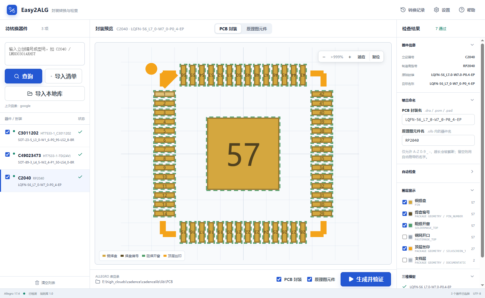
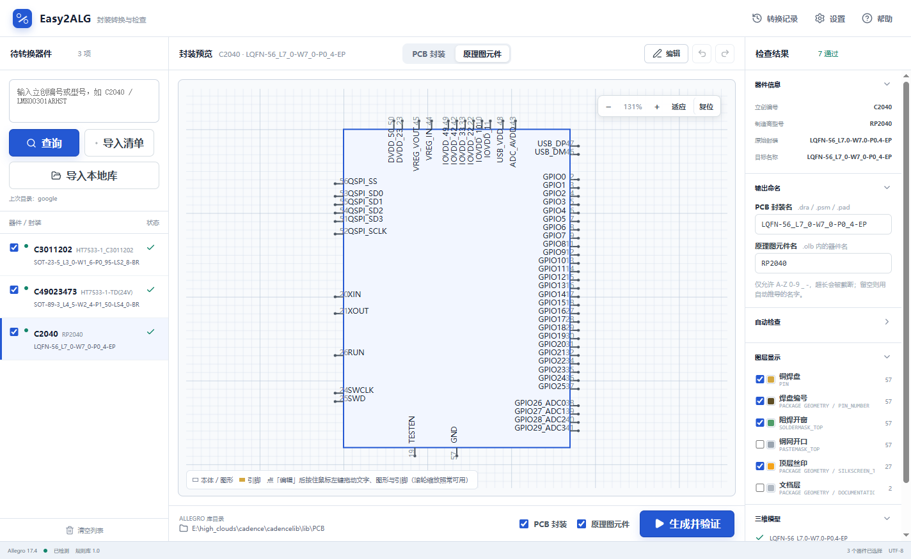

# Easy2ALG

把立创商城（LCSC）器件编号对应的 EasyEDA 封装，直接转换成 Cadence Allegro 的封装库和 OrCAD Capture 的原理图符号库，不需要 Altium Designer 中转。



## 能做什么

- **一个编号出全套产物**：`.dra` / `.psm`（PCB 封装）、`.pad`（焊盘栈）、`.ssm`（异形焊盘的形状符号）、`.olb`（原理图元件库）
- **按编号或型号批量转换**：输入 `C2040`、`STM32F407VGT6` 这类关键字查询，也可以一次粘贴多行编号；还能直接读 EasyEDA 导出的 `.elibz2` 本地库
- **生成前先看得见**：PCB 封装和原理图元件都能在画布上缩放、拖动、改图层颜色，符号引脚还能直接拖位置
- **生成后回读验证**：调用真实 Allegro 生成，再把 `.dra` 读回来核对引脚数和坐标，对不上就不报成功
- **异形焊盘不退化**：`PAD~POLYGON` 焊盘按原始多边形轮廓生成 shape symbol，不会变成包围盒矩形
- **名字可改**：PCB 封装名、原理图元件名都能在生成前改，并做合法性检查
- **自动更新**：安装版发现新版本可直接下载并重启安装

## 界面

窗口分三栏：左边是待转换清单，中间是预览画布（PCB 封装 / 原理图元件两个分页），右边是自动检查、输出命名和图层显示。

**PCB 封装页** —— 焊盘、阻焊开窗、钢网开口、丝印与装配外框分层显示，每层可单独开关和改颜色：


**原理图元件页** —— OrCAD Capture 符号预览，引脚名 / 编号、本体轮廓按最终写入 `.olb` 的几何渲染，可在画布上直接拖动调整：



### 自动检查

每个器件导入后先跑 7 项检查，把问题挡在生成之前：

| 检查项 | 说明 |
| --- | --- |
| 引脚数量 | 源数据里的引脚与机械焊盘是否都识别到 |
| 引脚编号唯一 | 重复编号会让 Allegro 建符号直接失败 |
| 焊盘尺寸有效 | 零尺寸、负尺寸、无效坐标 |
| 阻焊开窗 | 按铜焊盘外扩 0.05 mm，通孔双面开窗 |
| 钢网开口 | 普通焊盘 100%，大面积焊盘按 70% 开口率并提示确认 |
| 异形焊盘可转换 | 多边形轮廓的点数是否足够 |
| 孔定义 | 圆孔 / 槽孔的尺寸与镀铜属性 |

## 使用

1. 第一次启动时软件自动识别电脑上已安装的 Allegro（识别不到时手动指定 `allegro.exe`），再确认封装库目录。
2. 在输入框里粘贴一个或多个立创编号（每行一个即可）后点「查询」；也可以用「导入本地库」读 EasyEDA 导出的 `.elibz2`。
3. 在预览和自动检查里确认焊盘、丝印、阻焊与钢网规则，需要时改输出命名。
4. 勾选要生成的器件，点「生成并验证」。
5. 软件调用已安装的 Allegro 生成并回读检查，通过后把文件写进库目录。

### 产物

| 文件 | 用途 |
| --- | --- |
| `<封装名>.dra` | Allegro 封装源文件（可再编辑） |
| `<封装名>.psm` | 建板时引用的封装符号 |
| `<焊盘名>.pad` | 焊盘栈 |
| `<焊盘名>.ssm` | 异形焊盘的形状符号（shape symbol） |
| `<库名>.olb` | OrCAD Capture 原理图元件库 |

`.olb` 写好后，Capture 里要**关掉该库窗口再重新打开**（或刷新）才能看到新器件 —— Capture 不会自动刷新已经打开的库。

## 支持的 Allegro 版本

16.6、17.2、17.4、22.1、23.1、24.1、25.1，以及之后的新版本。版本号从安装路径 `SPB_x.y` 或程序文件版本号自动识别，Cadence 出新版本时不需要等软件更新。

Windows 是正式转换平台。软件只在找到真实的 Allegro 程序、并且目标文件确实生成且检查通过之后才显示成功。

## 异形焊盘

立创的 `PAD~POLYGON` 焊盘（SOT-89 中间脚、带引脚的热焊盘这类）没有对应的 Allegro 内建图形，软件会按原始多边形轮廓生成 shape symbol（`.ssm`）：铜箔一层，阻焊按外扩量再生成一层，和 `.pad` 一起写进同一个库目录。

Allegro 通过 `PADPATH` 查找 `.ssm`，把库路径指到这个目录就能正常引用，不会退化成包围盒矩形。

## 常见问题

**提示「立创 EDA 尚未绘制 …的引脚与焊盘」**
这个器件在立创商城有卖，但 EasyEDA 里还没画封装（商品页显示「暂未绘制」），没有数据可转。换用已绘制封装的型号，或自己补画。

**提示「未找到元件 C…」**
编号不存在或已下架，核对一下立创编号。

**生成失败**
状态栏会给出 Allegro 的原始报错，同时留下一个诊断目录，里面有 SKILL 脚本、`.jrl` 运行日志和 `build-process.log`，可以按里面的错误码排查。

## 自动更新

安装版启动 8 秒后自动检查一次新版本（设置页也能手动检查）：

1. 发现新版本 → 点「下载更新」，后台下载安装包并显示进度；
2. 下载完成 → 点「重启并安装」，软件退出、安装并自动重新打开。

免安装便携版没有安装目录可替换，不参与自动更新。自动更新读的是 Release 里的 `latest.yml`，发布时缺了它客户端就不会提示更新（发布脚本会直接报错拦下）。

## 开发

```bash
npm install
npm run dev      # 开发模式
npm run build    # 类型检查 + 单元测试 + 构建
npm run test     # 只跑单元测试
```

构建 Windows 安装包和免安装版：

```bash
npm run dist:win
```

这条命令先打包（一定产出 exe 到 `release/`），再按下面的规则决定要不要发布到 GitHub Releases：

- 两次发布间隔至少 **24 小时**；
- 同一个版本号**不重复发布**。

两条任一不满足时只会打包、不发版，退出码 `2`（正常跳过，不是错误）。所以发版前记得先抬 `package.json` 的版本号。

| 命令 | 作用 |
| --- | --- |
| `npm run dist:win` | 打包 + 按规则发布（主入口） |
| `npm run dist:win:local` | 只打包，不碰 GitHub |
| `npm run publish:github` | 构建后发布 |
| `npm run publish:github:only` | 只发布 `release/` 里现成的包 |
| `npm run publish:github:dry` | 只看发布计划 |

## 许可

MIT
